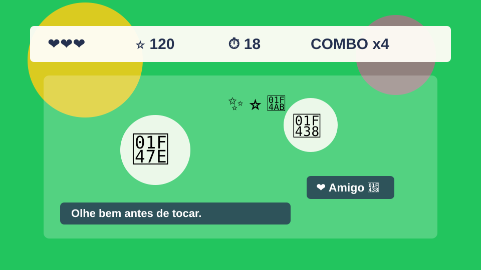

# Monster Hunt — An Educational Browser Game



A browser game built with HTML, CSS and JavaScript for children around age eight. Players catch monsters, protect the friendly character for each level, build combos and answer a short English vocabulary challenge to recover a life.

The interface and accompanying lessons are primarily Portuguese. This repository also serves as a readable example of arrays, objects, functions, conditions and browser storage.

## Play locally

Install Node.js for the built-in test runner and Python 3 for the local server. There are no npm dependencies to install.

```bash
git clone https://github.com/helberjf/child-project.git
cd child-project
npm start
```

Open `http://127.0.0.1:4173/`. The start script runs `python -m http.server 4173`; on systems where Python is named `python3`, run `python3 -m http.server 4173` directly. Use HTTP because JavaScript module imports may be blocked when opening `index.html` as a local file.

## Gameplay walkthrough

1. Start a game and identify the friendly monster shown before the level.
2. Wait for the countdown, capture other monsters and watch the life, timer and combo indicators.
3. Try the English challenge when offered, then inspect the words, records and medals screens.
4. Reload the page to inspect the locally saved progress.

The game includes several themed worlds and monster types. Progress storage is local; it is not a shared account or an assessment of a child's learning outcomes.

## Code tour and checks

| Source | Responsibility |
| --- | --- |
| [js/game.js](js/game.js), [js/game-flow.js](js/game-flow.js) | Main loop and game transitions |
| [js/levels.js](js/levels.js), [js/monster.js](js/monster.js) | Level setup and moving characters |
| [js/english.js](js/english.js), [data/palavras.js](data/palavras.js) | Vocabulary questions and word data |
| [js/storage.js](js/storage.js), [js/sounds.js](js/sounds.js) | Local persistence and audio |
| [aulas](aulas) | Fourteen programming lessons |
| [tests](tests) | Rules, English questions, UI helpers and layout checks |

```bash
npm test
```

Tests use Node's built-in runner. They do not replace playtesting with different screen sizes, input devices and accessibility settings. Asset notes remain in [images](assets/images/README.md), [sounds](assets/sounds/README.md), [backgrounds](assets/backgrounds/README.md) and [cursors](assets/cursors/README.md).

## Design tradeoffs

- **DOM animation with `requestAnimationFrame`:** familiar HTML/CSS makes characters easy to inspect and style, while many simultaneous elements can cost more layout/paint work than a dedicated rendering surface.
- **Framework-free modules:** the source exposes core JavaScript concepts directly, but game state and lifecycle coordination must be implemented explicitly.
- **Local progress:** records and vocabulary persist without registration or server storage, but stay on the same browser and can be cleared.
- **Vocabulary inside gameplay:** short questions connect learning content to an immediate reward; pedagogical effectiveness is not measured by the code or test suite.
